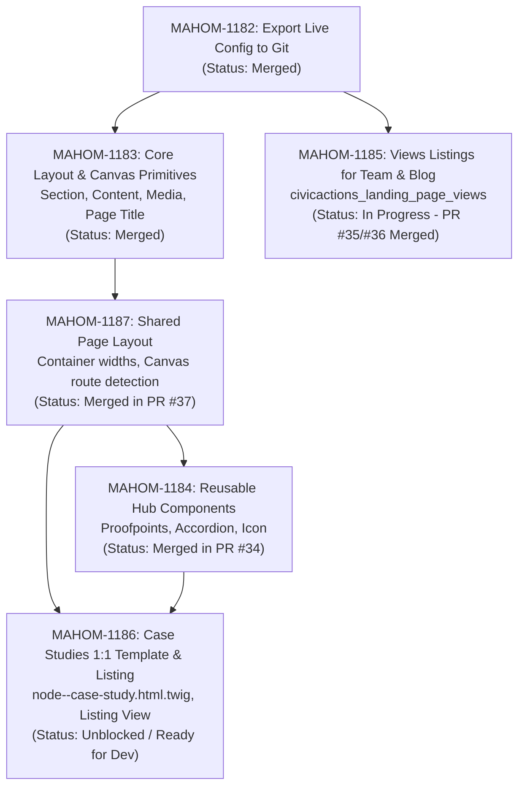

# Component Migration & Frontend Roadmap

Status: Active shared implementation plan
Audience: Contributors working on the CivicActions homesite rebuild
Target end date: November 1, 2026
Last reviewed: 2026-10-14

This plan records the complete component migration strategy from the legacy Strapi/Gatsby homesite to Drupal 11 and Drupal CMS 2.0. It coordinates the delivery of Twig Single Directory Components (SDCs), Drupal Canvas visual authoring integration, and structured Drupal Views listings.

For component styling standards, see [canon.md](../specs/canon.md). For design token definitions, see [design-tokens.md](../specs/design-tokens.md). For platform architecture decisions, see [ADR-0001](../decisions/0001-drupal-canvas-sdc-architecture.md).

---

## 1. Problem & Intended Outcome

The legacy homesite relied on a decoupled Gatsby frontend paired with a headless Strapi CMS and hardcoded React components. This split created editorial bottlenecks, duplicated layout code, and required engineering intervention for routine content and navigation updates.

The rebuild delivers an integrated Drupal CMS 2.0 architecture where:

- Content authors compose landing pages visually using Drupal Canvas and reusable, accessible SDCs.
- Structured content types (Case Studies, Editorial Articles, and Person listings) use semantic Twig templates and Views without requiring manual page assembly.
- Frontend components strictly encapsulate styles using the `.ca-` namespace and `@scope` progressive enhancement, eliminating bleed into Drupal admin chrome.

MAHOM-1168's header and main-menu code is merged in PR #18. Jira remains in Develop while the CMS menu configuration and environment visibility are completed. The animated or pinned-on-scroll header behavior is intentionally deferred post-MVP.

---

## 2. Component Migration Matrix

The homesite team audited all 39 legacy components and patterns against public production pages and editorial requirements. The migration keeps the current behavior where it helps editors, but it does not reproduce every Gatsby visual pattern:

| Legacy Component / Pattern | Audit Analysis & Architectural Decision | Status | Target Drupal SDC or Architecture | Ticket Reference | LOE |
| :--- | :--- | :--- | :--- | :--- | :--- |
| **`primary-page-cta.js`** | Full-width call-to-action banner supporting default (blue) and home (red) variants. | **Merged** | `omnichannel:primary-page-cta` | MAHOM-1167 | Done |
| **`link-button.js`** | Primary and secondary interactive link button primitive with default and large sizes. | **Merged** | `omnichannel:link-button` | MAHOM-1167 | Done |
| **`external-link-button.js`** | External link button. Folded into generalized button primitive with protocol sanitization. | **Merged** | Consolidated into `omnichannel:link-button` | MAHOM-1167 | Done |
| **`ditap-page-cta.js`** | Offering-specific CTA. Retired as duplicate; replaced with standard primary CTA variant. | **Merged** | Consolidated into `omnichannel:primary-page-cta` | MAHOM-1167 | Done |
| **`card.js`** | Linked card with icon, title, and body for offerings and service highlights. | **Merged** | `omnichannel:card` | MAHOM-1167 | Done |
| **`case-study-teaser.js`** | Teaser card for case study previews on Home, Services, and listing grid. | **Merged** | `omnichannel:case-study-teaser` | MAHOM-1167 | Done |
| **`press-release-teaser.js`** | Press release teaser. Consolidated into generalized editorial teaser supporting image card and compact text feed. | **Merged** | `omnichannel:editorial-teaser` | MAHOM-1167 | Done |
| **`hero-with-buttons.js`** | Comprehensive hero with eyebrow, heading, summary, image, and double CTAs. | **Text/CTAs merged; image implementation awaiting Canvas verification** | `omnichannel:hero` with optional image, 60:40 layout, and mobile image hiding | MAHOM-1179 (PR #14), Hero Media follow-up | Done |
| **`hero.js`** | Basic hero without CTAs. Consolidated into base hero component with optional action links. | **Merged** | Consolidated into `omnichannel:hero` | MAHOM-1179 | Done |
| **`case-study-hero.js`** | Content-specific case study hero. Consolidated into unified hero component. | **Merged** | Consolidated into `omnichannel:hero` | MAHOM-1179 | Done |
| **`quote.js`** | Testimonial quote with author citation, supporting optional portrait thumbnail. | **Merged** | `omnichannel:quote` | MAHOM-1167 | Done |
| **`staff-quote.js`** | Staff quote variant. Consolidated into unified quote component. | **Merged** | Consolidated into `omnichannel:quote` | MAHOM-1167 | Done |
| **`header.js` & `menus/main-menu/*`** | Sitewide header, desktop flyouts, mobile hamburger drawer, and skip link. | **Merged / CMS Validation Pending** | `omnichannel:main-menu` & `header.html.twig` | MAHOM-1168 (PR #18) | Done |
| **`red-header.js`** | Alternate red header variant. De-scoped; single cohesive header shell adopted sitewide. | **De-scoped** | Single header shell adopted sitewide | MAHOM-1168 | N/A |
| **`footer.js` & `menus/footer-menu.js`** | Sitewide multi-column footer, about summary, contact info, and legal links. | **Merged** | `omnichannel:site-footer` & partials | MAHOM-1174 | Done |
| **`social-icons/*`** | Social link collection (LinkedIn, GitHub) rendered in footer. | **Merged** | `omnichannel:social-links` | MAHOM-1174 | Done |
| **`skip-nav.js`** | Skip to main content accessibility control. | **Merged** | Built into page template shell | MAHOM-1175 | Done |
| **`teaser-grid.js`** | Staff card with portrait, name, and role for Team and offering pages. | **Merged** | `omnichannel:person-teaser` | MAHOM-1180 (PR #19) | Done |
| **`offering/bio.js`** | Short inline bio on person cards. Provided via optional bio prop. | **Merged** | Provided via `bio` prop in `omnichannel:person-teaser` | MAHOM-1180 | Done |
| **`-` (Layout Section)** | Responsive CSS Grid layout container (2, 3, 4 columns). Needs anchor ID and optional section title for in-page jump navigation. | **Merged** | `omnichannel:section` updates | MAHOM-1183 | Done |
| **Shared page layout & full-bleed model** | Cross-page contract for full-bleed backgrounds, 1200px containers, 720px editorial columns, Canvas page boundaries, and fixture parity. | **Merged** | `page.html.twig` width classes & `is_canvas_page` hook | MAHOM-1187 (PR #37) | Done |
| **`Text` (WYSIWYG)** | Rich text container for Utility pages (Privacy, 404) and service descriptions. Scoped typography (`@scope`) without admin bleed. | **Merged** | `omnichannel:content` | MAHOM-1183 | Done |
| **`Image` & `video.js` (Media SDC)** | Unified media embed primitive supporting responsive images and video embeds (16:9 ratio, caption, transcript support). | **Merged** | `omnichannel:media` | MAHOM-1183 | Done |
| **`page-title`** | Standalone semantic H1 heading component for Canvas landing pages, resolving Axe heading order violations. | **Merged** | `omnichannel:page-title` | MAHOM-1183 | Done |
| **`Proofpoints`** | Key statistical metrics (1 to 3 items, with or without boxed card background). Used on offering pages and Case Studies. | **Merged** | `omnichannel:proofpoints` | MAHOM-1184 (PR #34) | Done |
| **`Accordions`** | Single-item disclosure SDC plus a slot-based container for unlimited items on offering pages and FAQs. Gatsby CSS-triangle parity. | **Merged** | `omnichannel:accordion`, `omnichannel:accordion-container` | MAHOM-1184 (PR #34) | Done |
| **`icons.js`** | Scalable SVG icons for offering highlights. Pure Twig symbol catalog with brand tokens. | **Merged** | `omnichannel:icon` | MAHOM-1184 (PR #34) | Done |
| **`/team` Views Listing** | Views grid for `/team` filtered by role category. Cards remain unlinked for MVP (individual profile pages deferred). Placed as block view on Canvas page. | **In Progress** | `views.view.ca_team` in `civicactions_landing_page_views` | PR #35, PR #36 (MAHOM-1185) | Med |
| **`/blog` Views Listing** | Views feed for `/blog` with category filtering, rendering `editorial-teaser` in card and compact modes. | **In Progress** | `views.view.ca_articles` & `ca_news` | MAHOM-1185 | Med |
| **Case Study Node Template** | Structured 1:1 reproduction of legacy Case Studies assembling Hero, Proofpoints, Content, Media, and Quote SDCs without manual Canvas assembly. Unblocked by PR #37. | **Ready for Dev** | `node--case-study.html.twig` | MAHOM-1186 | Med |
| **Case Studies Grid Listing** | Responsive teaser grid at `/case-studies` rendering `case-study-teaser` cards with category filters. | **In Progress** | `views.view.ca_case_studies` | MAHOM-1186 | Med |
| **`sidebar.js`** | Legacy sticky sidebar. Replaced by Section SDC anchor jump links (`#web-cms`, etc.) on landing pages. | **De-scoped** | Replaced by Section SDC jump anchors | MAHOM-1183 | N/A |
| **`clients.js`** | Client and agency seal grid. The October 8 decision was to avoid governance risk from official seals and logos. | **De-scoped** | Text-based agency names or simple icons in standard Canvas sections; no custom logo rail | No ticket planned | N/A |
| **`tabmobile.js`** | Mobile tab navigation. | **De-scoped** | Permanently retired; use straightforward page flow and standard links | N/A | N/A |
| **`sections.js`** | Generic legacy content renderer. Replaced by Drupal Canvas layout system. | **Retired** | Replaced by Drupal Canvas layout system | N/A | N/A |
| **`seo.js`** | Social sharing and SEO tags. Handled via Drupal `metatag` module configuration (Dublin Core and Open Graph). | **Backend Core** | Drupal `metatag` module config | Core Config | Low |
| **`pagination.js`** | Pagination navigation. | **Core Views** | Drupal core Views mini/full pager | MAHOM-1185, MAHOM-1186 | Done in View |
| **`banner.js`** | Dismissible announcement banner. Placed via Canvas block. | **Canvas** | Standard Canvas banner block | Editorial | Low |
| **Careers Job Board (`/careers/`)** | Job board feed. Implemented as custom Drupal PHP block fetching Greenhouse JSON API, avoiding React dependencies. | **In Progress** | Custom Drupal block plugin with cache-clearing webhook | Backend | Med |
| **Configuration Sync** | Pull Pantheon Live database locally, export config to git (`config/`), and establish PR workflow. | **Merged** | Drupal config export (`ddev drush cex -y`) | MAHOM-1182 | Done |

---

## 3. Batched Implementation Phases

The delivery work is organized into ordered batches:



### Phase 1: DevOps Pre-Flight Configuration Sync (MAHOM-1182) - Merged

- **Problem:** Initial content types and taxonomies were created directly in the production CMS environment, while `config/` in git remains unpopulated.
- **Approach:** Pull production database locally, run `drush cex -y`, review configuration diff (content types, field storages, displays, vocabularies, and anonymous permissions), and open a pull request into `master`. Import downstream on lower environments.
- **Outcome:** Merged. Git is the single source of truth for site configuration.

### Phase 2: Core Layout & Canvas Primitives (MAHOM-1183) - Merged

- **Problem:** Canvas landing pages lack basic text, media, and heading primitives, and the Section SDC cannot support in-page anchor navigation.
- **Approach:**
  - Update `omnichannel:section` with optional `section_id` and `title` props.
  - Build `omnichannel:content` providing scoped prose typography (`@scope (.ca-content)`) without admin theme bleed.
  - Build `omnichannel:media` supporting responsive images and 16:9 video embeds with captions and transcript links.
  - Build `omnichannel:page-title` outputting a semantic H1 to resolve heading hierarchy accessibility errors.
- **Outcome:** Merged. Unblocks landing page authoring and resolves Axe accessibility violations.

The Storybook parity fixtures for this batch cover seven page archetypes: Homepage, Services, Team, Case Studies listing, DITAP Offering, Utility / General, and individual Case Study detail. They use inline Services anchors, text-based agency names, and no legacy tab interface.

### Phase 2.5: Shared Page Layout & Full-Bleed Template Model (MAHOM-1187) - Merged

- **Problem:** The existing page shell and Section component need a shared contract for full-width backgrounds, constrained content, and Canvas page boundaries.
- **Approach:** Define the page-template boundary, introduce `is_canvas_page` route detection, provide container width utility classes (`ca-container--full-width`, `ca-container--narrow`, `ca-container--default`), and validate the representative fixtures without negative-margin or `100vw` workarounds.
- **Outcome:** Merged in PR #37. Homepage, Services, Team, DITAP, Utility, and Case Study compositions share predictable layout behavior. Unblocks Phase 5 (Case Studies 1:1 theming) and Utility page styling.

### Phase 3: Reusable Hub Components (MAHOM-1184 / PR #34) - Merged

- **Problem:** Offering and campaign pages require statistical callouts, collapsible disclosures, and feature icons.
- **Approach:**
  - Build `omnichannel:proofpoints` supporting 1 to 3 key metrics with optional boxed card styling.
  - Build `omnichannel:accordion` as a single disclosure item with an `accordion_content` slot and Gatsby CSS border triangles.
  - Build `omnichannel:accordion-container` as a slot-based group with optional single-open behavior.
  - Build `omnichannel:icon` bundling SVG primitives with color and size tokens.
- **Outcome:** Merged in PR #34. Fulfills requirements for DITAP, Case Studies, and Homepage feature callouts.

### Phase 4: Views Listings for Team & Blog (MAHOM-1185) - In Progress

- **Problem:** Backend content migrations cannot be visually validated without listing views.
- **Approach:**
  - Build `/team` Views listing grouped by role category, rendering unlinked `person-teaser` cards (profile pages deferred post-MVP). Implemented in `civicactions_landing_page_views` module (`views.view.ca_team.yml`); filter operator fixes merged in PR #35 & PR #36.
  - Build `/blog` Views feed with category filtering, rendering `editorial-teaser` in card and compact modes (`views.view.ca_articles.yml` and `views.view.ca_news.yml`).
  - Confirm public anonymous view permissions for taxonomy vocabularies.
- **Outcome:** Placed as block views on Canvas pages, unblocking staff and blog migrations.

### Phase 5: Case Studies 1:1 Structured Reproduction (MAHOM-1186) - Unblocked / Ready for Dev

- **Problem:** Assembling repeating case studies manually in Canvas introduces layout drift and excessive authoring effort.
- **Approach:**
  - Theme `node--case-study.html.twig` to automatically assemble Hero, Proofpoints, Content, Media, and Quote SDCs from node fields, utilizing layout container classes established in PR #37.
  - Build `/case-studies` Views grid with category filtering (`views.view.ca_case_studies.yml`).
- **Outcome:** 1:1 legacy layout reproduction with zero manual page assembly for editors.

### Proposed Frontend Follow-Up Tickets

- **Hero Media and Image Presentation:** Add the optional Hero media treatment still visible in the legacy Homepage, Services, DITAP, and Case Study compositions.
- **Basic Page and Utility Template:** Give standard Privacy, Accessibility Statement, and Licensing nodes a predictable 720px reading layout using the existing Page Title and Content patterns.
- **No client logo rail ticket:** Agency seals and logos are intentionally replaced by text-based representations or simple icons in standard Canvas compositions.

---

## 4. Integration Boundaries

- **Greenhouse Job Board:** Handled as a custom Drupal PHP module fetching JSON from the Greenhouse API and exposing a configurable block plugin with an incoming webhook to trigger cache clears when jobs update. Removes redundant "Remote" from job titles. Avoids React dependencies or frontend SDC complexity.
- **SEO & Social Metadata:** Sitewide metadata handled via Drupal's `metatag` module (Dublin Core and Open Graph submodules), not custom Twig meta injections.
- **Taxonomy Permissions:** Core taxonomy access defaults to restricted in Drupal CMS; public vocabularies must have explicit anonymous view permissions exported in `config/`.

---

## 5. Validation Standards

Every component and layout change must satisfy the repository validation baseline before merge:

```text
ddev drush cr
ddev lint-css
ddev lint-js
cd web/themes/omnichannel && npm run build-storybook
```

Additionally:

- Review in theme-local Storybook across mobile (375px), tablet (768px), and desktop (1024px, 1280px) breakpoints.
- Perform pointer drag-and-drop verification in Drupal Canvas on the disposable draft page (`/canvas/editor/canvas_page/1`).
- Run Axe DevTools auditing to guarantee zero WCAG 2.1 AA violations.
