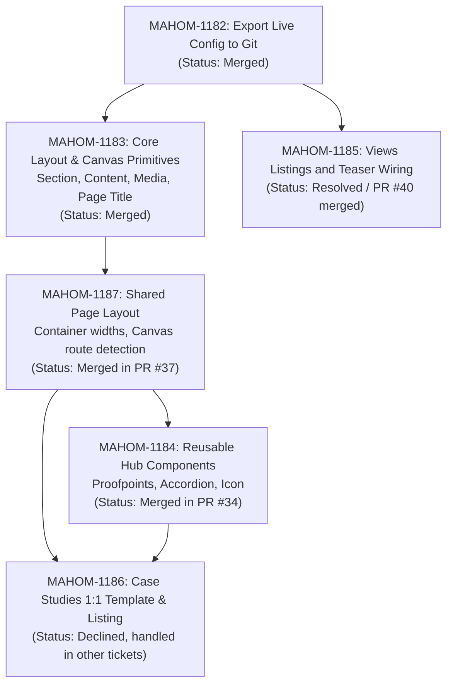

# Component Migration & Frontend Roadmap

Status: Active shared implementation plan
Audience: Contributors working on the CivicActions homesite rebuild
Target end date: November 1, 2026
Last reviewed: 2026-10-19

This plan records the complete component migration strategy from the legacy Strapi/Gatsby homesite to Drupal 11 and Drupal CMS 2.0. It coordinates the delivery of Twig Single Directory Components (SDCs), Drupal Canvas visual authoring integration, and structured Drupal Views listings.

For component styling standards, see [canon.md](../specs/canon.md). For design token definitions, see [design-tokens.md](../specs/design-tokens.md). For platform architecture decisions, see [ADR-0001](../decisions/0001-drupal-canvas-sdc-architecture.md).

---

## 1. Problem & Intended Outcome

The legacy homesite relied on a decoupled Gatsby frontend paired with a headless Strapi CMS and hardcoded React components. This split created editorial bottlenecks, duplicated layout code, and required engineering intervention for routine content and navigation updates.

The rebuild delivers an integrated Drupal CMS 2.0 architecture where:

- Content authors compose landing pages visually using Drupal Canvas and reusable, accessible SDCs.
- Structured content types (Case Studies, Editorial Articles, and Person listings) use semantic Twig templates and Views without requiring manual page assembly.
- Frontend components strictly encapsulate styles using the `.ca-` namespace and `@scope` progressive enhancement, eliminating bleed into Drupal admin chrome.

MAHOM-1168's header and main-menu code is merged in PR #18. Jira remains in Develop while the CMS menu configuration and environment visibility are completed. The animated or pinned-on-scroll header behavior is intentionally deferred post-MVP.

---

## 2. Component Migration Matrix

The homesite team audited all 39 legacy components and patterns against public production pages and editorial requirements. The migration keeps the current behavior where it helps editors, but it does not reproduce every Gatsby visual pattern:

| Legacy Component / Pattern | Audit Analysis & Architectural Decision | Status | Target Drupal SDC or Architecture | Ticket Reference | LOE |
| :--- | :--- | :--- | :--- | :--- | :--- |
| **`primary-page-cta.js`** | Full-width call-to-action banner supporting default (blue) and home (red) variants. | **Merged** | `omnichannel:primary-page-cta` | MAHOM-1167 | Done |
| **`link-button.js`** | Primary and secondary interactive link button primitive with default and large sizes. | **Merged** | `omnichannel:link-button` | MAHOM-1167 | Done |
| **`external-link-button.js`** | External link button. Folded into generalized button primitive with protocol sanitization. | **Merged** | Consolidated into `omnichannel:link-button` | MAHOM-1167 | Done |
| **`ditap-page-cta.js`** | Offering-specific CTA. Retired as duplicate; replaced with standard primary CTA variant. | **Merged** | Consolidated into `omnichannel:primary-page-cta` | MAHOM-1167 | Done |
| **`card.js`** | Linked card with icon, title, and body for offerings and service highlights. | **Merged** | `omnichannel:card` | MAHOM-1167 | Done |
| **`case-study-teaser.js`** | Teaser card for case study previews on Home, Services, and listing grid. | **Merged** | `omnichannel:case-study-teaser` | MAHOM-1167 | Done |
| **`press-release-teaser.js`** | Press release teaser. Consolidated into generalized editorial teaser supporting image card and compact text feed. | **Merged** | `omnichannel:editorial-teaser` | MAHOM-1167 | Done |
| **`hero-with-buttons.js`** | Comprehensive hero with eyebrow, heading, summary, image, and double CTAs. Supports optional `heading_level` (1 or 2, default 1) to prevent duplicate H1 tags on Canvas pages with multiple heroes. | **Merged** | `omnichannel:hero` with optional image, 60:40 layout, mobile image hiding, and `heading_level` prop | MAHOM-1179 (PR #14), MAHOM-1204 (PR #63) | Done |
| **`hero.js`** | Basic hero without CTAs. Consolidated into base hero component with optional action links and heading level. | **Merged** | Consolidated into `omnichannel:hero` | MAHOM-1179, MAHOM-1204 (PR #63) | Done |
| **`case-study-hero.js`** | Content-specific case study hero. Consolidated into unified hero component. | **Merged** | Consolidated into `omnichannel:hero` | MAHOM-1179 | Done |
| **`quote.js`** | Testimonial quote with author citation, supporting optional portrait thumbnail. | **Merged** | `omnichannel:quote` | MAHOM-1167 | Done |
| **`staff-quote.js`** | Staff quote variant. Consolidated into unified quote component. | **Merged** | Consolidated into `omnichannel:quote` | MAHOM-1167 | Done |
| **`header.js` & `menus/main-menu/*`** | Sitewide header, desktop flyouts, mobile hamburger drawer, and skip link. | **Merged / CMS Validation Pending** | `omnichannel:main-menu` & `header.html.twig` | MAHOM-1168 (PR #18) | Done |
| **`red-header.js`** | Alternate red header variant. De-scoped; single cohesive header shell adopted sitewide. | **De-scoped** | Single header shell adopted sitewide | MAHOM-1168 | N/A |
| **`footer.js` & `menus/footer-menu.js`** | Sitewide multi-column footer, about summary, contact info, and legal links. Links updated to canonical MVP routes matching live navigation. | **Merged** | `omnichannel:site-footer`, partials, and `menu.html.twig` routes | MAHOM-1174, PR #63 | Done |
| **`social-icons/*`** | Social link collection (LinkedIn, GitHub) rendered in footer. | **Merged** | `omnichannel:social-links` | MAHOM-1174 | Done |
| **`skip-nav.js`** | Skip to main content accessibility control. | **Merged** | Built into page template shell | MAHOM-1175 | Done |
| **`teaser-grid.js`** | Staff card with portrait, name, and role for Team and offering pages. | **Merged** | `omnichannel:person-teaser` | MAHOM-1180 (PR #19) | Done |
| **`offering/bio.js`** | Short inline bio on person cards. Provided via optional bio prop. | **Merged** | Provided via `bio` prop in `omnichannel:person-teaser` | MAHOM-1180 | Done |
| **`-` (Layout Section)** | Responsive CSS Grid layout container (2, 3, 4 columns). Needs anchor ID and optional section title for in-page jump navigation. | **Merged** | `omnichannel:section` updates | MAHOM-1183 | Done |
| **Shared page layout & full-bleed model** | Cross-page contract for full-bleed backgrounds, 1200px containers, 720px editorial columns, Canvas page boundaries, and fixture parity. | **Merged** | `page.html.twig` width classes & `is_canvas_page` hook | MAHOM-1187 (PR #37) | Done |
| **`Text` (WYSIWYG)** | Rich text container for Utility pages (Privacy, 404) and service descriptions. Scoped typography (`@scope`) without admin bleed. | **Merged** | `omnichannel:content` | MAHOM-1183 | Done |
| **`404 Page` (Not Found)** | Legacy-aligned 404 error template with centered 1200px layout, "Well, that's awkward." heading, team Zoom image, quick links, and Primary Page CTA. | **Merged** | `page--404.html.twig`, `not-found.css`, `system.404` suggestion | PR #62 | Done |
| **`Image` & `video.js` (Media SDC)** | Unified media embed primitive supporting responsive images and video embeds (16:9 ratio, caption, transcript support). | **Merged** | `omnichannel:media` | MAHOM-1183 | Done |
| **`page-title`** | Standalone semantic H1 heading component for Canvas landing pages, resolving Axe heading order violations. | **Merged** | `omnichannel:page-title` | MAHOM-1183 | Done |
| **`Proofpoints`** | Key statistical metrics (1 to 3 items, with or without boxed card background). Used on offering pages and Case Studies. | **Merged** | `omnichannel:proofpoints` | MAHOM-1184 (PR #34) | Done |
| **`Accordions`** | Single-item disclosure SDC plus a slot-based container for unlimited items on offering pages and FAQs. Gatsby CSS-triangle parity. | **Merged** | `omnichannel:accordion`, `omnichannel:accordion-container` | MAHOM-1184 (PR #34) | Done |
| **`icons.js`** | Scalable SVG icons for offering highlights. Pure Twig symbol catalog with brand tokens. | **Merged** | `omnichannel:icon` | MAHOM-1184 (PR #34) | Done |
| **`/team` Views Listing** | Views grid for `/team` defaulting to current members with internal/external filter hidden. Cards remain unlinked for MVP. Placed as a block view on the Canvas page below the Hero. | **Merged (PR #40 / MAHOM-1202 in PR #50)** | `views.view.ca_team` in `civicactions_landing_page_views` | MAHOM-1185, MAHOM-1202 | Done |
| **Editorial Views Listings** | Articles, News, and Publications listings render configured teaser SDCs. Current editorial routes include `/news`, `/publications`, and `/insights/articles`. | **Merged; Publications content follow-up remains** | `views.view.ca_articles`, `ca_news`, and `ca_publications` | MAHOM-1185, PR #40 | Done |
| **Editorial subtype landing pages** | Provide separate landing pages for Articles, Insights, Highlights, and News to support distinct URL structures and breadcrumbs. Confirm final route names with the content team. | **Backlog** | Editorial Views and Canvas page composition | MAHOM-1201 | TBD |
| **Case Study Node Template** | Rebuilt node theming for case studies matching the Omnichannel design tokens and SDC primitives. | **Merged (PR #45 / PR #48)** | `node--case-study.html.twig` & `case-study-header` | MAHOM-1162 | Done |
| **Case Studies Grid Listing** | Responsive teaser grid at `/case-studies` rendering `case-study-teaser` cards with category filters. | **Merged** | `views.view.ca_case_studies` | MAHOM-1185, PR #40 | Done |
| **`sidebar.js`** | Legacy sticky sidebar. Replaced by Section SDC anchor jump links (`#web-cms`, etc.) on landing pages. | **De-scoped** | Replaced by Section SDC jump anchors | MAHOM-1183 | N/A |
| **`clients.js`** | Client and agency seal grid. The October 8 decision was to avoid governance risk from official seals and logos. | **De-scoped** | Text-based agency names or simple icons in standard Canvas sections; no custom logo rail | No ticket planned | N/A |
| **`tabmobile.js`** | Mobile tab navigation. | **De-scoped** | Permanently retired; use straightforward page flow and standard links | N/A | N/A |
| **`sections.js`** | Generic legacy content renderer. Replaced by Drupal Canvas layout system. | **Retired** | Replaced by Drupal Canvas layout system | N/A | N/A |
| **`seo.js`** | Social sharing and SEO tags. Handled via Drupal `metatag` module configuration (Dublin Core and Open Graph). | **Backend Core** | Drupal `metatag` module config | Core Config | Low |
| **`pagination.js`** | Pagination navigation. | **Merged (PR #47)** | `omnichannel:link-button` & Views pager templates (legacy Back / Page X of Y / Next pattern) | MAHOM-1203 | Done |
| **Views exposed filters** | Token-based flexbox layout, 44px touch targets, uppercase Nunito bold labels, and Link Button submit styling with 3px focus rings across `/case-studies` and `/insights/articles`. For MVP, noisy taxonomy keyword/topic filters and non-functional quick-link headers are hidden. | **Merged (PR #50 & PR #64)** | `exposed-filters.css`, `views.view.ca_*` | MAHOM-1202 | Done |
| **`banner.js`** | Dismissible announcement banner. Placed via Canvas block. | **Canvas** | Standard Canvas banner block | Editorial | Low |
| **Careers Job Board (`/careers/`)** | Job board feed implemented as a custom Drupal PHP block fetching Greenhouse JSON. The sandbox is running; webhook setup remains before deployment. | **In Progress** | Custom Drupal block plugin with cache-clearing webhook | Backend | Med |
| **Configuration Sync** | Pull Pantheon Live database locally, export config to git (`config/`), and establish PR workflow. | **Merged** | Drupal config export (`ddev drush cex -y`) | MAHOM-1182 | Done |

---

## 3. Batched Implementation Phases

The delivery work is organized into ordered batches:



### Phase 1: DevOps Pre-Flight Configuration Sync (MAHOM-1182) - Merged

- **Problem:** Initial content types and taxonomies were created directly in the production CMS environment while `config/` in git was unpopulated, creating a risk of environment drift.
- **Approach:** Pull production database locally, run `drush cex -y`, review configuration diff (content types, field storages, displays, vocabularies, and anonymous permissions), and open a pull request into `master`. Import downstream on lower environments.
- **Outcome:** The initial Live configuration export merged. MAHOM-1193 remains in Backlog because the custom landing-page Views and Canvas placements are not yet safely owned by root config sync. A full config import is not safe until that work is complete.

### Phase 2: Core Layout & Canvas Primitives (MAHOM-1183) - Merged

- **Problem:** Canvas landing pages lack basic text, media, and heading primitives, and the Section SDC cannot support in-page anchor navigation.
- **Approach:**
  - Update `omnichannel:section` with optional `section_id` and `title` props.
  - Build `omnichannel:content` providing scoped prose typography (`@scope (.ca-content)`) without admin theme bleed.
  - Build `omnichannel:media` supporting responsive images and 16:9 video embeds with captions and transcript links.
  - Build `omnichannel:page-title` outputting a semantic H1 to resolve heading hierarchy accessibility errors.
- **Outcome:** Merged. Unblocks landing page authoring and resolves Axe accessibility violations.

The Storybook parity fixtures for this batch cover seven page archetypes: Homepage, Services, Team, Case Studies listing, DITAP Offering, Utility / General, and individual Case Study detail. They use inline Services anchors, text-based agency names, and no legacy tab interface.

### Phase 2.5: Shared Page Layout & Full-Bleed Template Model (MAHOM-1187) - Merged

- **Problem:** The existing page shell and Section component need a shared contract for full-width backgrounds, constrained content, and Canvas page boundaries.
- **Approach:** Define the page-template boundary, introduce `is_canvas_page` route detection, provide container width utility classes (`ca-container--full-width`, `ca-container--narrow`, `ca-container--default`), and validate the representative fixtures without negative-margin or `100vw` workarounds.
- **Outcome:** Merged in PR #37. Homepage, Services, Team, DITAP, Utility, and Case Study compositions share predictable layout behavior. Unblocks Phase 5 (Case Studies 1:1 theming) and Utility page styling.

### Phase 3: Reusable Hub Components (MAHOM-1184 / PR #34) - Merged

- **Problem:** Offering and campaign pages require statistical callouts, collapsible disclosures, and feature icons.
- **Approach:**
  - Build `omnichannel:proofpoints` supporting 1 to 3 key metrics with optional boxed card styling.
  - Build `omnichannel:accordion` as a single disclosure item with an `accordion_content` slot and Gatsby CSS border triangles.
  - Build `omnichannel:accordion-container` as a slot-based group with optional single-open behavior.
  - Build `omnichannel:icon` bundling SVG primitives with color and size tokens.
- **Outcome:** Merged in PR #34. Fulfills requirements for DITAP, Case Studies, and Homepage feature callouts.

### Phase 4: Views Listings and Teaser Wiring (MAHOM-1185) - Merged (PR #40)

- **Problem:** Backend content migrations cannot be visually validated without listing views.
- **Approach:**
  - Build `/team` Views listing grouped by role category, rendering unlinked `person-teaser` cards (profile pages deferred post-MVP). Implemented in `civicactions_landing_page_views` module (`views.view.ca_team.yml`); filter operator fixes merged in PR #35 & PR #36.
  - Provide editorial listings on `/news`, `/publications`, and `/insights/articles` using the configured Article, News, and Publications Views and `editorial-teaser` modes.
  - Render Person, Editorial, and Case Study teaser view modes through the existing Omnichannel SDCs, with responsive grid styling and bundle-specific field/media prop mapping in the theme.
  - Confirm public anonymous view permissions for taxonomy vocabularies.
- **Outcome:** PR #40 merged and MAHOM-1185 is resolved in Jira. The user reports that `/team`, `/news`, `/insights/articles`, and `/case-studies` render content on Live. `/publications` still needs investigation: the October 17 local Live database copy showed the matching Whitepaper fixture in Drupal Trash. Treat that as a snapshot finding until confirmed against current Live state; restore through the Trash UI if appropriate. The October 15 team sync also decided to create separate editorial subtype landing pages for Articles, Insights, Highlights, and News. Confirm final routes and ownership before implementation.

### Phase 5: Case Studies 1:1 Structured Reproduction (MAHOM-1186) - Declined

- **Disposition:** Jira resolved MAHOM-1186 as Declined with the note "Not needed, handled in other tickets." The Case Studies listing and teaser rendering are part of MAHOM-1185. Do not treat dedicated 1:1 node-template work as an active commitment without a new product decision.

### Proposed Frontend Follow-Up Tickets

- **Hero Media and Image Presentation:** Add the optional Hero media treatment still visible in the legacy Homepage, Services, DITAP, and Case Study compositions.
- **Outcomes Paragraph Card View Mode (post-MVP):** The Outcomes paragraph currently renders the Outcome Card SDC by overriding the default paragraph template (`paragraph--outcomes.html.twig`). Replace that with a dedicated `card` paragraph view mode: add `core.entity_view_mode.paragraph.card` and `core.entity_view_display.paragraph.outcomes.card` with both fields enabled and labels hidden, point the `field_outcomes` formatter on the Case Study displays at `card`, and rename the template to `paragraph--outcomes--card.html.twig`. This keeps the default Outcomes display available for other uses.
- **Basic Page and Utility Template:** Give standard Privacy, Accessibility Statement, and Licensing nodes a predictable 720px reading layout using the existing Page Title and Content patterns.
- **No client logo rail ticket:** Agency seals and logos are intentionally replaced by text-based representations or simple icons in standard Canvas compositions.

### October 15 Team Sync Decisions and Follow-Ups

- Create separate landing pages for Articles, Insights, Highlights, and News (MAHOM-1201). Confirm route paths and breadcrumb behavior with the content team.
- Defer dynamic topic taxonomy feeds and keyword filtering until after the summit (MAHOM-1205).
- Build the main Contact and DITAP forms with Drupal Webforms (MAHOM-1200). Keep embedded forms as a fallback if Webforms cannot be delivered within MVP scope. DITAP submissions must be available by email or CSV, and public forms require a service-based CAPTCHA.
- Owen is setting up site email, potentially through Mailgun, to support Webform notifications.
- Use Playwright to compare the Live site with PR environments (MAHOM-1204).
- Default the Team page to current team members and suppress the internal/external filter (MAHOM-1202). Pager styling is tracked in MAHOM-1203.
- Jack's next frontend work is to finish plugging teasers into Views and merge listing styles.

### October 26 Live Environment & Jira Reconciliation

- **Skeleton Canvas pages created on Live:** Jenna created skeleton Canvas Page entities on Live for `/case-studies` (Page 17), `/insights/articles` (Page 18), `/news` (Page 19), `/publications` (Page 21), `/careers` (Page 8), and `/contact` (Page 11). These currently override Drupal Views page routes with empty layouts. Placing the corresponding Views blocks (`ca_*_block_1`) and an H1 title on each page fixes this.
- **Team Listing Populated:** `/team` (Canvas Page 9) has `ca_team-block-1` placed and renders 112+ staff cards. Needs H1 title and intro mission copy.
- **Missing `/ditap` Route:** `/ditap` currently returns a 404 error; Canvas page not yet created.
- **Empty Publications Listing:** Node 13 ("Whitepaper test", TID 281) is soft-deleted in Drupal Trash, leaving `/publications` empty until restored or replaced with real content.
- **Full Node Displays:** Full node detail views for `editorial` (Articles/News) currently render raw Drupal core field labels ("Description", "Featured Image", "Article body", "Funnel stage"). Articles also lack the 720px narrow container in `page.html.twig`. Case Studies node theming is tracked in MAHOM-1162.
- **Forms & Greenhouse:** Webform module is uninstalled on Live; Greenhouse module (`civicactions_greenhouse`) is in `master` (`80b84ca`) but not yet enabled on Live.
- **Main Menu Links:** Fourteen links in the main navigation currently point to `internal:#`.
- **Target Launch:** First week of November 2026. Wednesday October 28 cowork is the primary milestone for Canvas assembly and forms integration.

### October 29 MVP Polish & PR Merge Reconciliation

- **PR #49 Merged:** Editorial node detail theming (`node--editorial--full.html.twig`, 720px narrow column, author/contributor fields, label suppression) merged to `master`.
- **PR #50 Merged:** Views exposed filters styled with token-based flexbox; `/team` defaults to current members without internal/external filter.
- **PR #51 Merged:** Comprehensive CI/CD pipeline merged by Owen (PR static checks, Playwright visual regression, Storybook build checks, and gated deployments).
- **PR #52 Merged:** Component margin spacing between section columns added by Jacqueline.
- **PR #61 Merged (MAHOM-1189):** Dedicated theming for Basic Page nodes merged by Iris (card-style hero rendering page title and short description, dedicated typography stylesheet, and overridable `node_title` block).
- **PR #62 Merged:** 404 Not Found error template (`page--404.html.twig`) extending `page.html.twig`, `@scope (.ca-not-found)` styles, team Zoom photo (`zoom-image.png`), quick navigation to `/`, `/careers/`, `/insights/`, and full-width Primary Page CTA.
- **PR #63 Merged (MAHOM-1204):** Hero SDC `heading_level` prop (default `1`, supports `2`) added to resolve duplicate H1 on Home; footer menu links mapped to canonical MVP routes (`/team/`, `/news/`, `https://reports.civicactions.com/2025`, `/services/`, `/case-studies/`, `/contracting/`, `/contact/`, `/insights/`, `/careers/`).
- **PR #64 Merged (MAHOM-1202):** Taxonomy keyword and topic filters set to `exposed: false` in `ca_articles` and `ca_case_studies` (both sync and install configs); non-functional quick-link header areas removed.
- **PR #66 Merged:** E2E test suite validation (functional, a11y, and visual suites) and selector fixes.
- **PR #67 Merged:** Reversible Medium legacy redirect sync command merged by Andy (`drush civicactions:medium-legacy-redirects` creates 301 redirects from legacy Medium paths to migrated editorial articles).
- **Active Open PRs:** Owen's multidev testing branches (PR #68, PR #60, PR #56) and Dependabot dependency updates (PR #57, PR #59).
- **Ticket Status Reconciliation:** `MAHOM-1160`, `MAHOM-1164`, `MAHOM-1165`, `MAHOM-1166`, and `MAHOM-1189` are all Delivered/Merged in code. Next critical engineering blocker is Webform / form embeds on Live (`MAHOM-1200`).

### October 28 Team Sync Decisions & Operational Alignment

- **Launch Strategy & QA Timeline:** Soft launch targeted for Wednesday November 4, 2026 (prioritizing low-risk release over public announcement). Holistic browser/mobile viewport QA conducted by Bridget on Monday November 2, with feedback remediation on Tuesday November 3.
- **Webform Priority & Live Error (`MAHOM-1200`):** The primary remaining functional blocker is Webform enablement on Live. Enabling the module caused an unexpected error that broke `/admin/modules`; Jack is investigating the error and configuration on Live. Implementation sequence: build the simple Contact form first to validate email delivery and Friendly CAPTCHA; convert the DITAP Google Form second, ensuring submissions route to Farook.
- **Team Page / In Memoriam Status Audit:** Team sync raised why *in memoriam* staff do not appear on `/team`. Root cause: `views.view.ca_team` filters on `field_profile_status` with `value: { current: current }`, intentionally excluding the 3 `in_memoriam` nodes. If desired, the filter value can be expanded to `{ current: current, in_memoriam: in_memoriam }` or broken into a dedicated memorial section. Staff profile detail links remain deferred post-MVP.
- **Case Studies & Articles Listing Filters:** Confirmed team consensus to hide the taxonomy keyword/topic filters for MVP to eliminate cluttered, duplicative term dropdowns (delivered in PR #64).
- **Medium Article Redirects:** Legacy Medium slug-hash redirects are operational via Andy's Drush command (PR #67); domain-level 301 redirect from `blog.civicactions.com` to `civicactions.com/insights/articles` remains on the switchover checklist.
- **Icon Library:** Post-MVP ticket to expand the current 6-icon catalog using the original Noun Project source library.

---

## 4. Integration Boundaries

- **Greenhouse Job Board:** Handled as a custom Drupal PHP module fetching JSON from the Greenhouse API and exposing a configurable block plugin with an incoming webhook to trigger cache clears when jobs update. Removes redundant "Remote" from job titles. Avoids React dependencies or frontend SDC complexity.
- **SEO & Social Metadata:** Sitewide metadata handled via Drupal's `metatag` module (Dublin Core and Open Graph submodules), not custom Twig meta injections.
- **Taxonomy Permissions:** Core taxonomy access defaults to restricted in Drupal CMS; public vocabularies must have explicit anonymous view permissions exported in `config/`.

---

## 5. Validation Standards

Every component and layout change must satisfy the repository validation baseline before merge:

```text
ddev drush cr
ddev lint-css
ddev lint-js
cd web/themes/omnichannel && npm run build-storybook
```

Additionally:

- Review in theme-local Storybook across mobile (375px), tablet (768px), and desktop (1024px, 1280px) breakpoints.
- Perform pointer drag-and-drop verification in Drupal Canvas on the disposable draft page (`/canvas/editor/canvas_page/1`).
- Run Axe DevTools auditing to guarantee zero WCAG 2.1 AA violations.
